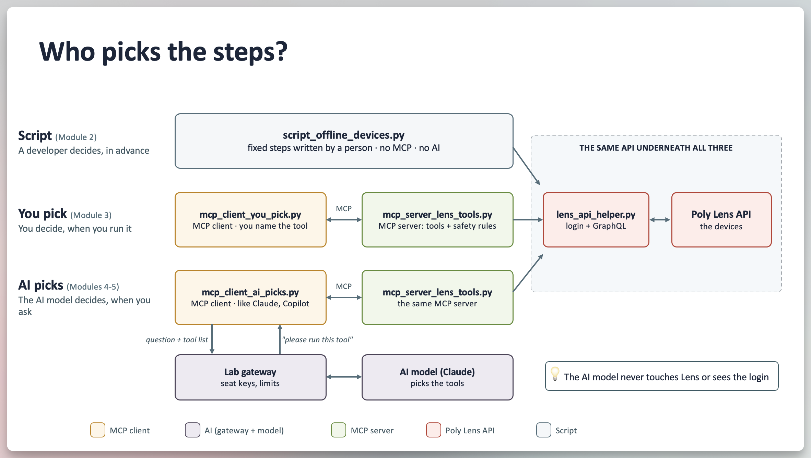
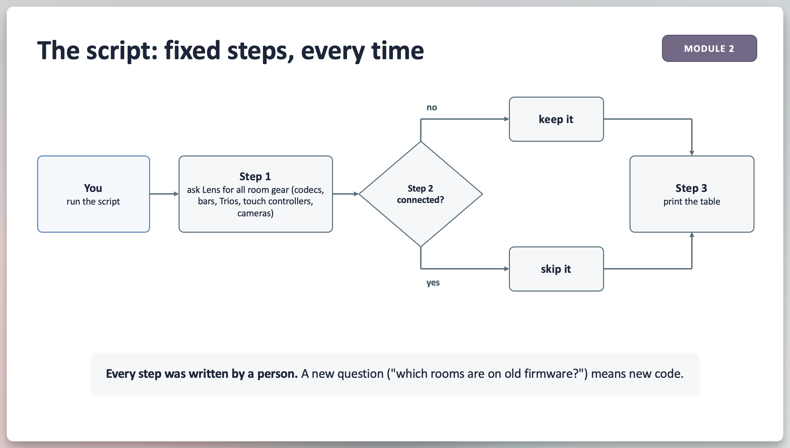
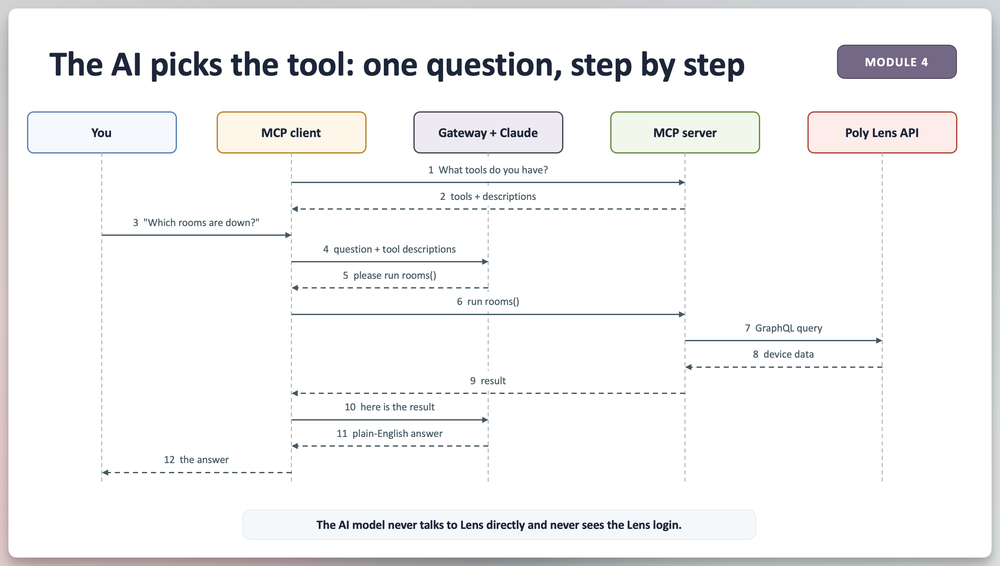

# Poly Lens API + MCP Hands-On Lab

## Overview

In the next hour you'll use Poly Lens API three ways:

- **Raw API:** talk to the API yourself
- **Script:** run the steps a developer wrote
- **MCP + AI:** ask a question in plain English and let an AI model choose the API calls

Everything runs in your web browser: no installs, no admin rights, no AI account, and no coding experiences needed. You'll copy commands, read output, and edit a few lines of code.

> ℹ️ **Note**
> Don't stress about finishing the lab today. This guide and every module works after the lab with sample data. See [Keep Going on Your Own](#keep-going-on-your-own).

## What You'll Learn

- **The Lens API value:** GraphQL describes itself, so programs (and AI models) can read its manual (schema)
- **Scripting with an API:** what it's good for, and where it stops
- **What MCP is:** a standard way to hand an AI model a set of tools
- **How an AI model uses MCP:** it never touches Lens itself; it asks an app to run tools
- **How to keep an AI agent safe:** where the hard limits live

---

## Key Terminology

| TERM                             | WHAT IT IS                                                                                                                                                                      | EVERYDAY COMPARISON                                                       |
| -------------------------------- | ------------------------------------------------------------------------------------------------------------------------------------------------------------------------------- | ------------------------------------------------------------------------- |
| **API**                          | A way for programs to ask another system for data or to do something                                                                                                            | A restaurant's order window: you ask in a set format, the kitchen answers |
| **GraphQL**                      | The kind of API Lens uses: you ask for exactly the fields you want, in one request                                                                                              | Ordering à la carte instead of a fixed menu                               |
| **Schema**                       | The API's built-in, machine-readable manual                                                                                                                                     | The full menu, with ingredients                                           |
| **Introspection**                | Asking a GraphQL API for its own schema                                                                                                                                         | Asking the waiter for the menu                                            |
| **OAuth token**                  | A temporary pass sent with every API request; the credential behind it decides what you can see and do                                                                          | A visitor badge from reception                                            |
| **Script**                       | A program that follows the exact steps a person wrote                                                                                                                           | A recipe                                                                  |
| **LLM / AI model**               | The "brain" that reads your question and decides which tools to use. It can't run anything itself                                                                               | A smart colleague who can only tell you what to do                        |
| **MCP** (Model Context Protocol) | An open standard for offering tools to an AI model: a name, a description, and the inputs each tool needs                                                                       | A universal plug: any AI app that speaks MCP can use any MCP server       |
| **MCP server**                   | The program that offers the tools and runs them. It holds the Lens login and the safety rules                                                                                   | The kitchen: it does the actual work                                      |
| **MCP client**                   | The app that connects the AI model to the MCP server and passes messages back and forth. Claude and Copilot are MCP clients                                                     | The waiter, carrying orders and plates                                    |
| **Lab gateway**                  | A small service Daniel built for this lab. It connects everyone to the AI model with **one** shared account. Your **seat key** gives you access and limits how much you can use | A company switchboard                                                     |
| **Codespace**                    | Your own Linux computer in GitHub's cloud, opened as VS Code in your browser                                                                                                    | A rented, ready-made workshop                                             |
| **`.env`**                       | A settings file in your Codespace (your seat key, Lens credentials). It's private and never shared                                                                              | Your sticky note of passwords, kept in your drawer                        |
| **Sample data**                  | `LENS_MOCK=1`: built-in pretend devices instead of a real Lens account. The commands work the same                                                                              | A flight simulator                                                        |

---

## The Big Picture



### Files You'll Use

| FILE                         | WHAT IT DOES                                                                              | MODULE |
| ---------------------------- | ----------------------------------------------------------------------------------------- | ------ |
| `lens_api_helper.py`         | Logs in to Lens and sends GraphQL queries. Every Lens query lives here                    | All    |
| `script_offline_devices.py`  | The developer way: fixed steps that list offline room devices                             | 2      |
| `mcp_client_you_pick.py`     | MCP client where **you** pick the tool. No AI involved                                    | 3      |
| `mcp_server_lens_tools.py`   | MCP server with tools built for Lens, plus the safety rules                               | 3–5    |
| `mcp_client_ai_picks.py`     | MCP client where **the AI model** picks the tools: what Claude and Copilot do             | 4–5    |
| `mcp_server_reads_schema.py` | MCP server with **no Lens code**: it reads the schema and runs the AI model's own queries | 4      |
| `mcp_server_setup_check.py`  | One-tool MCP server that checks your setup works                                          | Setup  |
| `.env`                       | Your private settings                                                                     | Setup  |

### Lab Flow

| MODULE                 | YOU'LL DO                                           |
| ---------------------- | --------------------------------------------------- |
| Access Tools           | Open your Codespace, add your settings, quick check |
| 1. Talk to the API     | Log in, ask the API what it can do                  |
| 2. Script It           | Run a script, see its strengths and limits          |
| 3. Make It an MCP Tool | Call tools by hand, turn the script into a tool     |
| 4. Let the AI Pick     | Ask questions in plain English, watch every step    |
| 5. Fix Things Safely   | Reboot a device with approval (simulated)           |
| 6. Lab vs. Real World  | What changes in a customer deployment; Q&A          |

Steps marked ⏩ are extras. Skip them if you're short on time and come back later.

---

## Lab Tools Access

All you need is a web browser and a **GitHub account** (a free personal account works).


### Step 1: Open the Codespace

- Open the link Daniel shared and sign in to GitHub if asked
- Wait 2–3 minutes, until the terminal shows a prompt (`$`)

### Step 2: Trust the Folder

- If VS Code asks _"Do you trust the authors of the files in this folder?"_, select **Trust Folder & Continue**

> ℹ️ **Note**
> Without this, VS Code opens in _Restricted Mode_ and some features stay off.

### Step 3: Add Your Settings

In the file list, open **`.env`**:

- After `POLY_LENS_CLIENT_ID=` and `POLY_LENS_CLIENT_SECRET=`, paste the Lens credentials found in `seat-key.csv`
- After `LAB_LLM_API_KEY=`, paste the key assigned to you in `seat-key.csv`
- Leave `LAB_LLM_BASE_URL` as it is
- Save (Ctrl/Cmd+S)

> 🔑 **Formatting**
> No spaces and no quotes around values. Keys never contain `0`, `o`, `1`, `l` or `i`.
> ℹ️ **No Lens Credential?**
> Set `LENS_MOCK=1` to use built-in sample data. Every module still works.

### Step 4: Quick Check

```bash
LAB_SERVER=mcp_server_setup_check.py python mcp_client_ai_picks.py "Run the lab check"
```

**What happens:** a green **AI ANSWER** box says MCP is working for your GitHub username.

That one answer proves every piece works: the MCP client, the lab gateway, the AI model and an MCP server.

> 🔒 **Privacy**
> `.env` stays in your Codespace and is never shared. Your seat key only works with the lab gateway and is switched off after the lab.

---

## Module 1 · Talk to the API

**Goal:** see how GraphQL **describes itself** and ships its own machine-readable manual (the schema). We're just observing it right now, but in Module 4 an AI model reads the same manual.


### Step 1: Log In

```bash
python lens_api_helper.py token
```

**What happens:** `Got an access token: ...`. Your app proved who it is and got a temporary pass to access the Lens tenant data

### Step 2: Ask the API What It Can Do

```bash
python lens_api_helper.py ops
```

**What happens:**

- A long list of every `Query` (read) and `Mutation` (change) the API supports, with descriptions
- The last line provides the counts

**Nobody wrote this list by hand.** The API produced it from its own schema. Scroll up to see all of it.

### ⏩ Step 3: Ask for Exactly What You Want

- Open `lens_api_helper.py` and find `DEVICE_FIELDS`
- We're asking for a subset of the available `deviceSearch` fields because that's all we need

**Checkpoint:** _Why does "the API describes itself" matter for an AI model?_
The AI model can look up what's possible while it works, instead of someone pre-programming every question.

---

## Module 2 · Script It

**Goal:** solve one problem the traditional way, and see its strengths and limits. You'll be running a python script that uses the Lens API `deviceSearch` query to determine which devices are offline (not connected to Lens).



### Step 1: Run It

```bash
python script_offline_devices.py
```

**What happens:** a count and a table of offline devices

### Step 2: Read the Steps

- Open `script_offline_devices.py` and read `get_offline_devices()`
- Every step was written by a person
- Even what counts as "room gear" is a decision someone wrote down once (`ROOM_GEAR` in `lens_api_helper.py`)

### Step 3: Think About It

Your manager now asks _"which rooms are on outdated firmware?"_ What would you have to do?
(Write a new script.)

### ⏩ Step 4: Add a Column

Add a **FIRMWARE** column. The two lines to change are marked `exercise:` in the print section:

- Header line: add `{'FIRMWARE':16}` before `{'LAST SEEN'}`
- Row line: add `{device['firmware'] or '':16}` before `{device['last_seen']}`

Run the script again.

**Checkpoint:** _Name one thing the script is great at, and one thing it can't do._

---

## Module 3 · Make It an MCP Tool

**Goal:** see that an MCP tool is just **a function + a description**, and call tools by hand with no AI involved.


### Step 1: See What the Server Offers

```bash
python mcp_client_you_pick.py
```

**What happens:** 7 tools, each with a one-line description.

**Those descriptions are what an AI model reads to decide which tool to use.**

### Step 2: Call a Tool Yourself

```bash
python mcp_client_you_pick.py rooms status=degraded
```

**What happens:** the rooms that need attention, with their devices.

// How Room Status Works

| STATUS   | MEANING                                                                                   |
| -------- | ----------------------------------------------------------------------------------------- |
| down     | The primary device (the codec, PC or video bar that runs the room) is offline             |
| degraded | The primary device is online, but a peripheral (touch controller, camera, mic) is offline |
| unknown  | Lens didn't report the primary device's state                                             |
| healthy  | Everything is online                                                                      |

### Step 3: Turn Your Script into a Tool

Open `mcp_server_lens_tools.py`, find `MODULE 3 EXERCISE`, and remove the `# ` from the start of these 5 lines:

```python
from script_offline_devices import get_offline_devices
@mcp.tool()
def offline_devices() -> str:
    """List room gear that is currently offline, with model, room, firmware and last seen."""
    return json.dumps(get_offline_devices(), indent=2)
```

Save.

> 👀 **Indentation - Important!**
> The last two lines start with exactly 4 spaces. Remove only the `# `, not the spaces after it.

### Step 4: Check It's There

```bash
python mcp_client_you_pick.py
python mcp_client_you_pick.py offline_devices
```

**What happens:**

- 8 tools now
- `offline_devices` returns the same devices as your script

**What just happened:** the code didn't change. You added one line (`@mcp.tool()`) and a description. That's all "exposing a capability via MCP" means.

**Checkpoint:** _In this module, who decided which tool to call?_
You did. In Module 4, that changes.

---

## Module 4 · Let the AI Pick (12 min)

**Goal:** let the AI model choose the tools, including for questions nobody wrote a tool for.



### Step 1: Start the Chat

```bash
python mcp_client_ai_picks.py
```

// Reading the Output

Each line is one hop in the diagram above:

| LINE                         | WHAT HAPPENED                                                                                              | DIAGRAM STEP |
| ---------------------------- | ---------------------------------------------------------------------------------------------------------- | ------------ |
| `[1] MCP CLIENT -> AI MODEL` | The MCP client sends your question and the list of tools the AI model may use                              | 4            |
| `[2] AI MODEL -> MCP CLIENT` | The AI model asks the MCP client to run one tool. **It never runs anything itself**                        | 5            |
| `[3] TOOL RESULT`            | The MCP client ran the tool on the MCP server, which called Lens. The result goes back with the next `[1]` | 6–9          |
| **AI ANSWER** box            | The AI model's answer, written only from those results                                                     | 10–12        |

### Step 2: Ask Questions

Ask one at a time:

1. `Which rooms are down or degraded?`
2. `Why is <a room from the first answer> degraded, and how long has that device been offline?`

Type `exit` when you're done.

### Step 3: An MCP Server with No Lens Code

`mcp_server_reads_schema.py` has 3 generic tools: read the schema, describe a type, run a read-only query. No device tools, no room logic, no hand-written Lens queries.

```bash
LAB_SERVER=mcp_server_reads_schema.py python mcp_client_ai_picks.py "Which devices are offline? Show name, model and last seen."
```

**What happens:** watch the `[2]` lines:

- The AI model reads the manual (`schema_overview`, `describe_type`)
- Then it **writes its own GraphQL query** (`run_query`)
- If Lens answers with an error, the AI model reads it and fixes its query

This works because GraphQL describes itself. A REST API without a published, machine-readable manual needs someone to build a tool for each feature before an AI model can use it.

> ℹ️ **Note**
> This step needs real Lens data. Sample data only answers the lab's own queries.

### ⏩ Step 4: A Question Nobody Wrote a Tool For

```bash
python mcp_client_ai_picks.py "Which rooms have devices on older firmware than other devices of the same model?"
```

> ⚠️ **Rate Limit**
> Each `[1]` line is one request through the lab gateway, about 20 per minute per seat. If you see `Lab gateway: Rate limit`, wait the seconds shown.

**Checkpoint:** _Both servers answered. What does each one need from a developer, and when would you want each?_

|                   | TOOLS BUILT FOR LENS                     | READS THE SCHEMA                        |
| ----------------- | ---------------------------------------- | --------------------------------------- |
| Developer work    | Write and maintain each tool             | None                                    |
| Speed and cost    | Fewer steps, fewer AI requests           | More steps                              |
| Business rules    | Built in (e.g. what counts as room gear) | Not in the schema                       |
| New Lens features | Need a tool update                       | Usable as soon as they're in the schema |

---

## Module 5 · Fix Things Safely

**Goal:** see how an AI model can fix things **without** being able to do anything it wants.


### Step 1: Ask for a Reboot

Start the chat (`python mcp_client_ai_picks.py`) and ask to reboot the **online** device Daniel shares in the lab chat.

**What happens:** the AI model shows a **PLAN** and asks for approval.

The server forced this: the first call always has `confirm=false`.

### Step 2: Approve It

Reply: `yes, go ahead`

**What happens:** `SIMULATED: would send this mutation...`

Your Codespace is in **simulate** mode, so nothing reached Lens.

### Step 3: Try an Offline Device

Ask to reboot the **offline** device Daniel shares.

**What happens:** `NOT POSSIBLE: ... is offline in Lens`

Commands reach a device over its cloud connection, so an offline device can't receive one. The server checks this **before** anything else; the AI model can't talk its way around it.

// Safety Layers, and Who Enforces Each

| SAFETY LAYER          | ENFORCED BY                                                    | CAN THE AI MODEL GET AROUND IT?                                       |
| --------------------- | -------------------------------------------------------------- | --------------------------------------------------------------------- |
| Ask before acting     | The tool design (`confirm` flag) + the AI model's instructions | Only by ignoring its instructions, which is why the next layers exist |
| Only online devices   | MCP server checks Lens first                                   | No                                                                    |
| Simulate mode         | MCP server setting (`LAB_MODE`)                                | No                                                                    |
| Device allowlist      | MCP server setting (`LAB_ALLOWED_DEVICE_IDS`)                  | No                                                                    |
| Read-only credential  | Poly Lens itself                                               | No                                                                    |
| Model, limits, budget | Lab gateway                                                    | No                                                                    |

### ⏩ Step 4: See the Server Refuse

Settings typed before `python` override `.env`. Nothing the AI model sends can change them:

```bash
LAB_MODE=live python mcp_client_you_pick.py reboot_device device_id=<online device id> confirm=true
```

**What happens:** `BLOCKED: live mode requires LAB_ALLOWED_DEVICE_IDS to be set.`

**Checkpoint:** _Why should the hard limits live in the server, not in the AI model's instructions?_

---

## Module 6 · Lab vs. Real World

Daniel walks through this one. The tables are here to come back to.

| IN THIS LAB                                               | IN A CUSTOMER DEPLOYMENT                                                                  |
| --------------------------------------------------------- | ----------------------------------------------------------------------------------------- |
| `mcp_client_ai_picks.py` + Claude Haiku                   | Claude, Microsoft Copilot, or another MCP client                                          |
| Lab gateway: one AI account, seat keys, limits, usage log | The company's AI platform or gateway: single sign-on, model choice, spend controls, audit |
| MCP server runs in _your_ Codespace                       | MCP server runs centrally (a container in the company's cloud)                            |
| Client and server talk inside one Codespace               | They talk over HTTPS, with authentication                                                 |
| `.env` file                                               | A secrets manager (AWS Secrets Manager, Azure Key Vault...)                               |
| One shared read-only Lens credential                      | Separate read and admin credentials; admin tools only for the right team                  |
| Simulate mode + allowlist                                 | Change-control rules, approvals, and a log of every tool call                             |
| Everyone sets up their own                                | An admin adds the connection **once** for the whole company                               |

// Script vs. MCP + AI

| QUESTION                    | SCRIPT                           | MCP + AI                                              |
| --------------------------- | -------------------------------- | ----------------------------------------------------- |
| Who decides the steps?      | The developer, in advance        | The AI model, when the question is asked              |
| A new question?             | Someone writes new code          | It combines existing tools, or reads the API's manual |
| Same result every time?     | Yes                              | Usually similar, not guaranteed                       |
| Cost per run                | Practically free                 | AI usage per question                                 |
| Easy to review and approve? | Very: review the code once       | Needs server-side safety rules + logs                 |
| Best for...                 | Scheduled, repeatable, bulk jobs | Troubleshooting, one-off questions, non-developers    |

**They work together:** proven script functions become MCP tools (Module 3), and the AI model decides when to use them.

---

## Keep Going on Your Own

Everything still works after the lab, at your own pace.

### Your Codespace

- Reopen it from github.com/codespaces ↗
- A stopped Codespace is kept for up to 30 days without use
- Free personal GitHub accounts include monthly Codespaces hours (a 1-hour lab uses about 2% of them)
- To keep your changes long-term, create a fork when VS Code offers it on your first commit

### Sample Data

- Set `LENS_MOCK=1` in `.env`. The lab's Lens credential is removed after the lab

### Your Own AI API Key

The lab gateway is switched off after the lab. To keep using Modules 4–5:

1. If you want to follow the lab exactly, create an account in the Anthropic Console (platform.claude.com ↗). Add a small credit and create an API key
2. In `.env`:

   ```bash
   LAB_LLM_BASE_URL=https://api.anthropic.com/v1
   LAB_LLM_API_KEY=<your Anthropic API key>
   LAB_MODEL=claude-haiku-5-5
   ```

> ℹ️ **Note**
> A Claude Pro subscription doesn't include API credit. Any AI provider with an OpenAI-compatible chat API and tool calling works the same way: change these three lines.

### Things to Try

- The ⏩ steps above
- Read `ask()` in `mcp_client_ai_picks.py`: the whole "AI assistant" loop is one function
- Read `mcp_server_reads_schema.py`: an MCP server for any GraphQL API, in about 100 lines

---

## Troubleshooting

| WHAT YOU SEE                                                | LIKELY CAUSE                                             | FIX                                                               |
| ----------------------------------------------------------- | -------------------------------------------------------- | ----------------------------------------------------------------- |
| Codespace won't open / blank page                           | Company network blocks `github.dev`                      | Tell Daniel; pair with a neighbour                                |
| **Restricted Mode** at the bottom left                      | The folder isn't trusted yet                             | Select **Restricted Mode** » **Trust**                            |
| VS Code offers to load `.env` into terminals                | Python extension prompt                                  | Select **Don't Show Again**; the lab reads `.env` itself          |
| `Set LAB_LLM_API_KEY in .env`                               | `.env` not saved, or key on the wrong line               | Reopen `.env`, check `LAB_LLM_API_KEY=lab-...`, save              |
| `Set LAB_LLM_BASE_URL in .env`                              | The gateway address is missing                           | Copy the `LAB_LLM_BASE_URL=` line from `.env.example` into `.env` |
| `Your lab key was not accepted`                             | Typo, extra space or quotes                              | Retype the key from your seat card                                |
| `Lab gateway: Rate limit...`                                | More than ~20 requests in a minute                       | Wait the seconds shown                                            |
| `The lab gateway isn't answering (HTTP 502)`                | Gateway stopped or unreachable                           | Tell Daniel                                                       |
| `The lab gateway is closed` / `AI budget is used up`        | Gateway switched off or budget reached                   | Tell Daniel                                                       |
| `The model provider rejected the lab gateway` / `is busy`   | Problem between the gateway and the AI provider          | Tell Daniel; retry in a minute                                    |
| `Can't reach the lab gateway`                               | Gateway not running, or the lab is over                  | During the lab: tell Daniel. After: use your own key              |
| `POLY_LENS_CLIENT_ID / POLY_LENS_CLIENT_SECRET are not set` | Lens credential missing from `.env`                      | Add it, or set `LENS_MOCK=1`                                      |
| `Lens didn't return a token`                                | Wrong client ID or secret                                | Retype both from the lab chat                                     |
| `Mock mode only supports...`                                | The AI model wrote its own query while using sample data | Expected; ask about rooms or devices instead                      |
| `Unknown tool: offline_devices`                             | Module 3 exercise not done                               | Uncomment the 5 lines in `mcp_server_lens_tools.py`               |
| `IndentationError` after Module 3                           | Spaces lost when uncommenting                            | The last two lines need exactly 4 spaces at the start             |
| `Stopped after 8 steps`                                     | Question too broad                                       | Ask a narrower question                                           |
