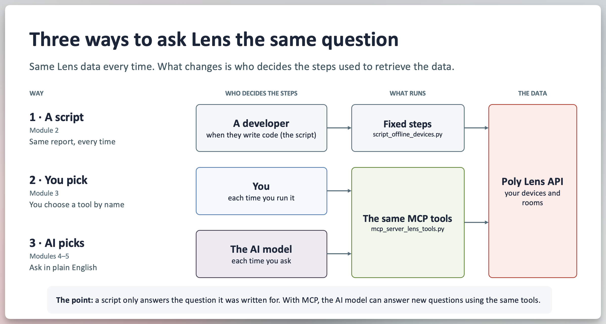
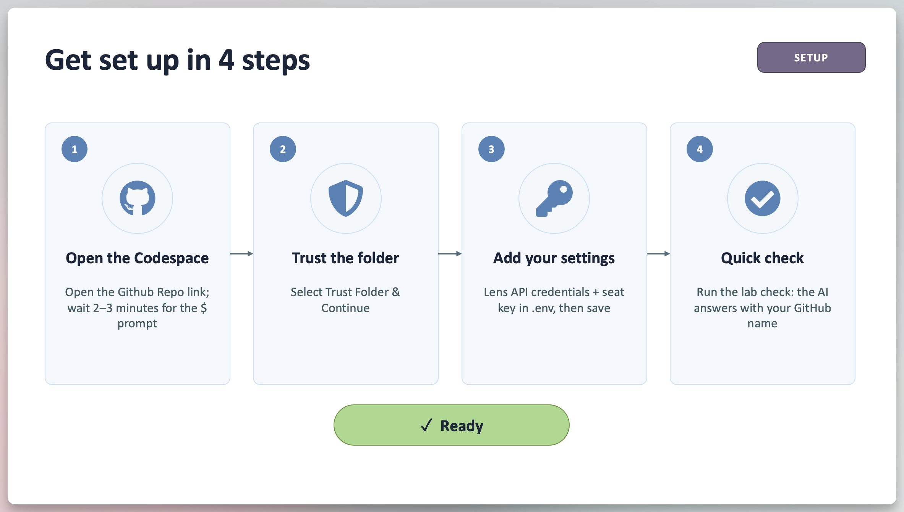
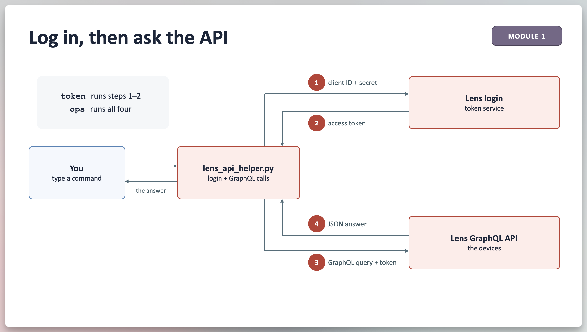
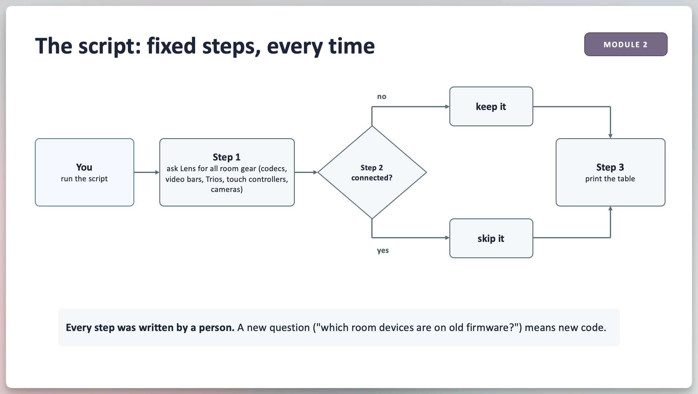
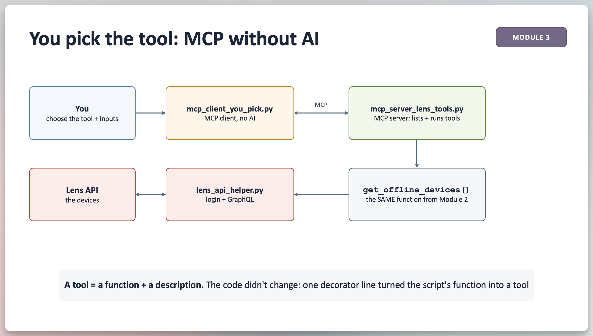
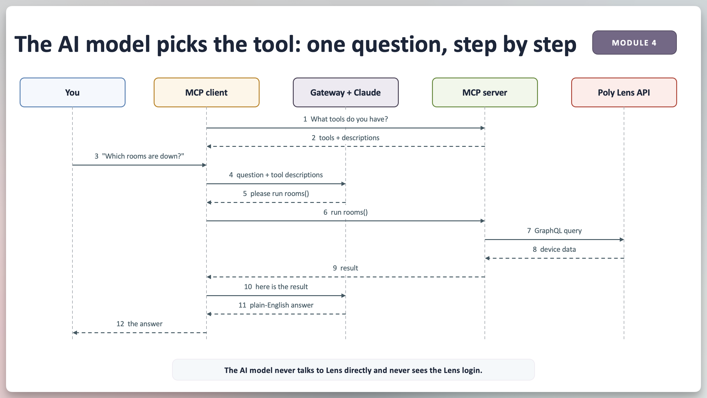
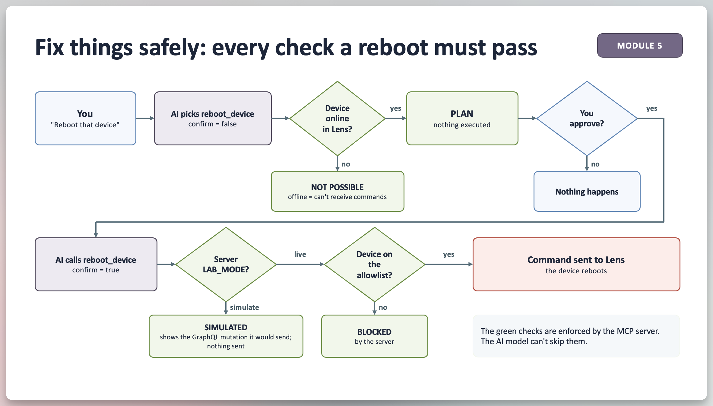

# Poly Lens API + MCP Hands-On Lab

## Overview

This hands-on lab is designed to demonstrate the customer value in using the Lens API to optimize their workflow and solve a problem. You'll answer one customer question three different ways:

- **A Script:** run a script that demonstrates how a developer would write it
- **You pick:** choose a ready-made MCP tool yourself
- **AI picks:** ask in plain English and let an AI model choose the tools

Everything runs in your web browser: no installs, no admin rights, no AI account, and no coding experience needed. You'll copy & execute commands (in the Codespace terminal window), read the output, and change a few lines.

> ℹ️ **Note**
> Every module works after the lab with sample data. See [Keep Going on Your Own](#keep-going-on-your-own). New words are explained in [Key Terms](#key-terms) at the end.

---

## The Scenario

Meet **Sam**, the IT admin at one of your customers. Sam is responsible for a few hundred Poly devices in meeting rooms across several sites. He manages these devices in Poly Lens.

Every Monday morning Sam has the same question:

> _"Which meeting rooms have a problem right now, and can I fix it without walking there?"_

Sam has also heard that Neat and Zoom offer "MCP servers", and asks you:

> _"Can Poly Lens work with AI assistants like Copilot or Claude? Do you have a Poly Lens MCP server, too?"_

In this lab, you'll walk the same path Sam's team would:

| MODULE                 | SAM'S SITUATION                                         | WHAT YOU'LL DO                                            |
| ---------------------- | ------------------------------------------------------- | --------------------------------------------------------- |
| Lab Tools Access       | Sam gets Lens API access to his data and an AI model    | Open your Codespace and add 3 settings                    |
| 1. Talk to the API     | "What can Lens tell me about the APIs available?"       | Authenticate to the Lens API and read its built-in manual |
| 2. Script It           | "I ask the same question every morning"                 | Run a script that creates a list of your offline devices  |
| 3. Make It an MCP Tool | "I want our AI assistant to be able to do that too"     | Turn the script into a tool and call it yourself          |
| 4. Let the AI Pick     | "I'd rather just ask in plain English"                  | Ask questions and watch the AI model choose the tools     |
| 5. Fix Things Safely   | "Can it reboot a device? What stops it doing too much?" | Ask for a reboot and see every safety check               |
| 6. Lab vs. Real World  | "How would this look in our company?"                   | Daniel walks through a real deployment; Q&A               |

By the end you'll be able to answer Sam's questions, and you'll have seen each answer work.

Steps marked ⏩ are extras. Skip them if you're short on time.

---

## The Big Picture



The device data we ask the Lens API to send us doesn't change. What changes is **who decides the steps** to use to get the data.

- **A script:** a developer decided when they wrote the code (script).
- **You pick:** the steps are wrapped up as MCP tools, and you choose which tool to run
- **AI picks:** the **same mcp tools**, but the AI model chooses which ones to run, based on your question

### Files You'll Use

You don't need to understand these files before you start. Each module tells you which one to open.

| FILE                         | WHAT IT DOES                                                                                | MODULE |
| ---------------------------- | ------------------------------------------------------------------------------------------- | ------ |
| `.env`                       | Your private settings                                                                       | Setup  |
| `lens_api_helper.py`         | Logs in to Lens and sends the questions (GraphQL queries). Every Lens query lives here      | All    |
| `script_offline_devices.py`  | The script: fixed steps that list offline room devices                                      | 2      |
| `mcp_server_lens_tools.py`   | MCP server: tools built for Lens, plus the safety rules                                     | 3–5    |
| `mcp_client_you_pick.py`     | MCP client where **you** pick the tool. No AI involved                                      | 3      |
| `mcp_client_ai_picks.py`     | MCP client where **the AI model** picks the tools: what Claude and Copilot do               | 4–5    |
| `mcp_server_reads_schema.py` | MCP server with **no Lens code**: it reads the API's manual and runs the AI model's queries | 4      |
| `mcp_server_setup_check.py`  | One-tool MCP server that checks your setup works                                            | Setup  |

---

## Lab Tools Access

**Scenario:** before Sam can ask anything, two things need to be in place: a way to **reach the Lens data** and a way to **reach an AI model**.

All you need is a web browser and a **GitHub account** (a free personal account works).



### Step 1: Open the Codespace

- Open the link Daniel shared and sign in to GitHub if asked
- Wait 2–3 minutes, until the terminal on the right shows a prompt (`$`)

**Why:** a Codespace is a ready-made computer in the cloud with everything installed, so nobody has to set up Python on a work laptop.

### Step 2: Trust the Folder

- If VS Code asks _"Do you trust the authors of the files in this folder?"_, select **Trust Folder & Continue**

> ℹ️ **Note**
> Without this, VS Code opens in _Restricted Mode_ and some features stay off.

### Step 3: Add Your 3 Settings

**Why:** your Codespace needs two passes, like visitor badges:

- **A Lens pass** (client ID + client secret), so it can retrieve device data from your Lens tenant. Everyone shares the same **read-only** pass: it can look, but Lens won't let it change anything
- **An AI pass** (your seat key), so it can reach the AI model in Modules 4–5. Each person gets their own, so usage is counted per seat

**Where to find them:** open `lab-keys.csv` [HPTRC » Poly Lens » /usr/share/lens-vault (bottom of page) » Poly Lens » 02-api](https://hp.sharepoint.com/:x:/t/PolyTechnicalResourceCenter/cQp1gbvOmPYaSJlvh8Ln51iDEgUCxnh-yk7Fm88L4s53xyePWw)

The `POLY_LENS_CLIENT_ID` and `POLY_LENS_CLIENT_SECRET` are at the top of the file. Your seat key is on the row with your name.

// Do This

1. In your codespace, look at the file Explorer list on the left, click **`.env`** to open it
2. in the **`.env`**, find the 3 lines below. Paste each value **directly after the `=`**
3. Don't change any other line
4. Save: **Ctrl+S** (Windows) or **Cmd+S** (Mac)

| LINE IN `.env`             | PASTE                      | STARTS WITH |
| -------------------------- | -------------------------- | ----------- |
| `POLY_LENS_CLIENT_ID=`     | Client ID from the CSV     | (any)       |
| `POLY_LENS_CLIENT_SECRET=` | Client secret from the CSV | (any)       |
| `LAB_LLM_API_KEY=`         | **Your** seat key          | `lab-`      |

When you're done, those lines look like this (except with your values, not these made-up values):

```bash
POLY_LENS_CLIENT_ID=AbC123dEf456
POLY_LENS_CLIENT_SECRET=xYz789-long-secret-text
LAB_LLM_API_KEY=lab-abcd-efgh-jkmn
```

> 🔑 **Common Mistakes**
>
> - A space after the `=`, or quotes around the value
> - Pasting on the wrong line, or a new line instead of after the `=`
> - Forgetting to save (a dot next to `.env` on its tab means it isn't saved)

> ℹ️ **Stuck for more than 3 minutes?**
> Change `LENS_MOCK=0` to `LENS_MOCK=1` and save. You'll use built-in sample devices instead of the real Lens account, and every module still works. Ask Daniel when there's a moment.

### Step 4: Quick Check

We'll be running commands in the built-in terminal, located at the bottom of the codespace window. It should be open and sitting at an empty terminal prompt. When you see a line in a standalone code block (like the one below this paragraph):

Copy the full line, paste it in the terminal, and press Enter:

```bash
LAB_SERVER=mcp_server_setup_check.py python mcp_client_ai_picks.py "Run the lab check"
```

**What happens:** a green **AI ANSWER** box says MCP is working for your GitHub username.

**Why:** this one question goes through every piece you'll use later (the MCP client, the lab gateway, the AI model and an MCP server), so a problem shows up now instead of in Module 4.

> ℹ️ **What's `LAB_SERVER=` at the start?**
> A setting typed before `python` applies to that one command only. Here it says "use the setup-check server" instead of the usual one.

> 🔒 **Privacy**
> `.env` stays in your Codespace and is never shared. Your seat key only works with the lab gateway and is switched off after the lab.

---

## Module 1 · Talk to the API

**Scenario:** before automating anything, Sam wants to know: _"What can the Lens API tell me about the data I can ask for and what can it do?"_ That's what an API answers.

**What you'll get:** you'll see that the Lens API comes with its own manual (the **schema**) that a program can read. Keep this in mind: in Module 4, an AI model reads the same manual to work out questions on its own.



### Step 1: Log In

```bash
python lens_api_helper.py token
```

**What happens:** `Got an access token: ...`

**Why:** every request to Lens must carry a temporary pass that proves who's asking. The Lens API credentials behind it determines what you can see and do. Yours is read-only.

### Step 2: Ask the API What It Can Do

```bash
python lens_api_helper.py ops
```

**What happens:**

- A long list of everything the API supports, each with a description
- **Query** = read something (e.g. search devices). **Mutation** = change something (e.g. reboot a device)
- The last line counts them

**Why:** nobody wrote this list by hand. The API produced it from its own schema. Scroll up and look for something Sam would care about, like `deviceSearch` or a reboot.

### ⏩ Step 3: Ask for Exactly What You Want

- Open `lens_api_helper.py` and find `DEVICE_FIELDS`
- That list is the request: name, model, firmware, room... Lens returns only those fields

**Why:** with GraphQL (the kind of API Lens uses), you ask for exactly the fields you need, in one request.

**Checkpoint:** _Why does "the API describes itself" matter for an AI model?_

<details><summary>Answer</summary>

The AI model can look up what's possible while it works, instead of someone writing code for every question in advance.

</details>

---

## Module 2 · Script It

**Scenario:** every morning Sam asks the same thing: _"Which room devices are offline?"_ A question that never changes is perfect for a script: it's free to run, gives the same answer every time, and can run on a schedule.

**What you'll get:** you'll run that script, see what it's great at, and find where it stops being useful.



### Step 1: Run It

```bash
python script_offline_devices.py
```

**What happens:** a count and a table of offline devices, with model, room and when Lens last saw them.

**Why:** this is Sam's Monday report, ready in a few seconds.

### Step 2: Read the Steps

- Open `script_offline_devices.py` and find `get_offline_devices()`
- Read it top to bottom: search Lens for room gear (duplicate records are merged), keep only the offline devices, and pick the fields to show

**Why:** every one of those steps was decided by a person, in advance. Even what counts as "room gear" is a list someone wrote down once (`ROOM_GEAR` in `lens_api_helper.py`).

### Step 3: Think About It

Sam's manager now asks: _"Which rooms are on outdated firmware?"_

What would Sam have to do? (Answer: get a developer to edit the existing script.)

**Why:** in a way, this is the script's limit. It answers the question it was written for, and nothing else. Sam's dev team might be capable of making the edits right away...or they might have a lengthy lead-time for changes.

### ⏩ Step 4: Add a Column

Even a small change, like adding a **FIRMWARE** column, means editing code. The two lines to change are marked `exercise:` in the print section:

- Header line: add `{'FIRMWARE':16}` before `{'LAST SEEN'}`
- Row line: add `{device['firmware'] or '':16}` before `{device['last_seen']}`

Save, and run the script again.

**Checkpoint:** _Name one thing the script is great at, and one thing it can't do._

<details><summary>Answer</summary>

Great at: the same question, every day, quickly and for free. Can't do: any new question without someone changing or writing additional code.

</details>

---

## Module 3 · Make It an MCP Tool

**Scenario:** Sam's company uses an AI assistant (Copilot or Claude) and Sam wants to ask it about rooms. But an AI assistant can only use tools someone gave it. So step one is to turn the steps that already work into **MCP tools**.

**What you'll get:** you'll see that an MCP tool is just **a function + a description**, and you'll call tools yourself, with no AI involved yet.



### Step 1: See What the Server Offers

```bash
python mcp_client_you_pick.py
```

**What happens:** 7 tools, each with a one-line description.

**Why:** this is exactly what an AI assistant sees when it connects. **It reads those descriptions to decide which tool to use**, so good descriptions matter.

### Step 2: Call a Tool Yourself

```bash
python mcp_client_you_pick.py rooms status=degraded
```

**What happens:** returns the rooms that need attention, with their devices.

**Why:** before handing a tool to an AI model, you check it does what it says. This is the "you pick" way: you choose the tool and the inputs.

// How Room Status Works

| STATUS   | MEANING                                                                                   |
| -------- | ----------------------------------------------------------------------------------------- |
| down     | The primary device (the codec, PC or video bar that runs the room) is offline             |
| degraded | The primary device is online, but a peripheral (touch controller, camera, mic) is offline |
| unknown  | Lens didn't report the primary device's state                                             |
| healthy  | Everything is online/connected to Poly Lens                                               |

### Step 3: Turn Your Script into a Tool

Now give the AI assistant Sam's Monday report from Module 2.

Open `mcp_server_lens_tools.py`, find `MODULE 3 EXERCISE`, and remove the `# ` from the start of these 5 lines:

```python
from script_offline_devices import get_offline_devices
@mcp.tool()
def offline_devices() -> str:
    """List room gear that is currently offline, with model, room, firmware and last seen."""
    return json.dumps(get_offline_devices(), indent=2)
```

Save it.

> 👀 **Indentation - Important!**
> The last two lines start with exactly 4 spaces. Remove only the `# `, not the spaces after it.

**Why:** you're not rewriting the script. You're reusing it: `@mcp.tool()` says "offer this as a tool", and the line in quotes is the description the AI model will read.

### Step 4: Check It's There

```bash
python mcp_client_you_pick.py
python mcp_client_you_pick.py offline_devices
```

**What happens:**

- 8 tools now
- `offline_devices` returns the same devices as your script

**What just happened:** the script's code didn't change. You added one line and a description. That's all "exposing a capability via MCP" means.

**Checkpoint:** _In this module, who decided which tool to call?_

<details><summary>Answer</summary>

You did. In Module 4, the AI model decides.

</details>

---

## Module 4 · Let the AI Pick

**Scenario:** Sam doesn't want to remember tool names. Sam wants to type _"Which rooms have a problem?"_ and get an answer, including for questions nobody built a tool for.

**What you'll get:** you'll watch, step by step, how an AI assistant uses MCP tools. You'll also answer Sam's question _"Do you need an MCP server like Neat and Zoom?"_



### Step 1: Start the Chat

```bash
python mcp_client_ai_picks.py
```

**Why:** this small app does what Copilot and Claude do behind the scenes, but it prints every step so you can see the process.

// Reading the Output

Each line is one hop in the diagram above:

| LINE                         | WHAT HAPPENED                                                                                              | DIAGRAM STEP |
| ---------------------------- | ---------------------------------------------------------------------------------------------------------- | ------------ |
| `[1] MCP CLIENT -> AI MODEL` | The MCP client sends your question and the list of tools the AI model may use                              | 4            |
| `[2] AI MODEL -> MCP CLIENT` | The AI model asks the MCP client to run one tool. **It never runs anything itself**                        | 5            |
| `[3] TOOL RESULT`            | The MCP client ran the tool on the MCP server, which called Lens. The result goes back with the next `[1]` | 6–9          |
| **AI ANSWER** box            | The AI model's answer, written only from those results                                                     | 10–12        |

### Step 2: Ask Sam's Questions

Ask one at a time:

1. `Which rooms are down or degraded?`
2. `Why is <a room from the first answer> degraded, and how long has that device been offline?`

Type `exit` when you're done.

**Why:**

- **Question 1** is Sam's Monday question. Watch the `[2]` line: the AI model picked the `rooms` tool, the same one you ran by hand in Module 3
- **Question 2** is a follow-up. The AI model remembers the first answer and picks a different tool to dig into one device. Nobody wrote a script for that

### Step 3: An MCP Server with No Lens Code

**Scenario:** Sam asks _"Neat and Zoom have MCP servers. Does Poly need one?"_ This step shows why the answer is "not necessarily".

`mcp_server_reads_schema.py` has only 3 general tools: read the API's manual, look up one part of it, and run a read-only query. No device tools, no room logic, no Lens queries written by a person.

```bash
LAB_SERVER=mcp_server_reads_schema.py python mcp_client_ai_picks.py "Which devices have a linked peripheral that's offline? List up to 10, with the device, the peripheral and when it was last seen."
```

**What happens:** watch the `[2]` lines:

- The AI model reads the manual (`schema_overview`, `describe_type`)
- Then it **writes its own GraphQL query** (`run_query`)
- If Lens answers with an error, the AI model reads it and fixes its query

**Why:** this only works because GraphQL describes itself (Module 1).

With an API that has no machine-readable manual, someone has to build a tool for each feature first, which is why some vendors ship their own MCP server.

// Same Question, Tools Built for Lens

```bash
python mcp_client_ai_picks.py "Which devices have a linked peripheral that's offline? List up to 10, with the device, the peripheral and when it was last seen."
```

**What happens:** the AI model can use the `rooms` tool, which already links each device to its peripherals. Count the `[1]` lines and compare with the run above.

**Why:** fewer steps means a faster, cheaper answer. That's when building tools pays off.

> ℹ️ **Note**
> This step needs real Lens data. Sample data only answers the lab's own queries.

### ⏩ Step 4: A Question Nobody Wrote a Tool For

```bash
python mcp_client_ai_picks.py "Which rooms have devices on older firmware than other devices of the same model?"
```

**Why:** this is the manager's question from Module 2. The script couldn't answer it; the AI model combines the tools it has.

> ⚠️ **Rate Limit**
> Each `[1]` line is one request through the lab gateway, about 20 per minute per seat. If you see `Lab gateway: Rate limit`, wait the seconds shown.

**Checkpoint:** _The reads-schema server answered with no Lens code at all. So why build tools like `rooms`?_

<details><summary>Answer</summary>

Speed, cost, consistent answers, and business rules the schema doesn't know (like what counts as room gear). Start general; build tools where they pay off.

|                   | TOOLS BUILT FOR LENS                     | AI MODEL WRITES ITS OWN QUERIES         |
| ----------------- | ---------------------------------------- | --------------------------------------- |
| Developer work    | Write and maintain each tool             | None                                    |
| Speed and cost    | Fewer steps, fewer AI requests           | More steps                              |
| Business rules    | Built in (e.g. what counts as room gear) | Not in the schema                       |
| New Lens features | Need a tool update                       | Usable as soon as they're in the schema |

</details>

---

## Module 5 · Fix Things Safely

**Scenario:** Sam finds a device that needs a reboot and asks the AI assistant to do it. Sam's security team immediately asks: _"What stops it from rebooting every device in the building?"_

**What you'll get:** you'll see that an AI model can only do what the MCP server allows, and that the hard limits live in the server, not in the AI model.



### Step 1: Ask for a Reboot

Start the chat (`python mcp_client_ai_picks.py`) and ask to reboot the **online** device Daniel shares in the lab chat.

**What happens:** the AI model shows a **PLAN** and asks for approval.

**Why:** the reboot tool always returns a plan first, and only acts when called again with `confirm=true`. That gives Sam a chance to say no.

### Step 2: Approve It

Reply: `yes, go ahead`

**What happens:** `SIMULATED: would send this mutation...`

**Why:** your Codespace is in **simulate** mode, so nothing reached Lens. It's how you'd test an AI assistant before trusting it with real devices.

### Step 3: Try an Offline Device

Ask to reboot the **offline** device Daniel shares.

**What happens:** `NOT POSSIBLE: ... is offline in Lens`

**Why:** commands reach a device over its cloud connection, so an offline device can't receive one. The server checks this **before** anything else; the AI model can't talk its way around it.

// Safety Layers, and Who Enforces Each

| SAFETY LAYER          | ENFORCED BY                                                    | CAN THE AI MODEL GET AROUND IT?                                       |
| --------------------- | -------------------------------------------------------------- | --------------------------------------------------------------------- |
| Ask before acting     | The tool design (`confirm` flag) + the AI model's instructions | Only by ignoring its instructions, which is why the next layers exist |
| Only online devices   | MCP server checks Lens first                                   | No                                                                    |
| Simulate mode         | MCP server setting (`LAB_MODE`)                                | No                                                                    |
| Device allowlist      | MCP server setting (`LAB_ALLOWED_DEVICE_IDS`)                  | No                                                                    |
| Read-only credential  | Poly Lens itself                                               | No                                                                    |
| Model, limits, budget | Lab gateway                                                    | No                                                                    |

### ⏩ Step 4: See the Server Refuse

Settings typed before `python` override `.env`, and nothing the AI model sends can change them:

```bash
LAB_MODE=live python mcp_client_you_pick.py reboot_device device_id=<online device id> confirm=true
```

**What happens:** `BLOCKED: live mode requires LAB_ALLOWED_DEVICE_IDS to be set.`

**Why:** even in live mode, the server only changes devices on an approved list. That's the answer for Sam's security team.

**Checkpoint:** _Why should the hard limits live in the server, not in the AI model's instructions?_

<details><summary>Answer</summary>

An AI model follows instructions most of the time, not every time. The server's rules apply every time, whatever the AI model asks for.

</details>

---

## Keep Going on Your Own

Everything still works after the lab, at your own pace.

### Your Codespace

- Reopen it from github.com/codespaces ↗
- A stopped Codespace is kept for up to 30 days without use
- Free personal GitHub accounts include monthly Codespaces hours (a 1-hour lab uses about 2% of them)
- To keep your changes long-term, create a fork when VS Code offers it on your first commit

### Sample Data

- Set `LENS_MOCK=1` in `.env`. The lab's Lens credential is removed after the lab

### Your Own AI API Key

The lab gateway is switched off after the lab. To keep using Modules 4–5:

1. If you want to follow the lab exactly, create an account in the Anthropic Console (platform.claude.com ↗). Add a small credit and create an API key
2. In `.env`:

   ```bash
   LAB_LLM_BASE_URL=https://api.anthropic.com/v1
   LAB_LLM_API_KEY=<your Anthropic API key>
   LAB_MODEL=claude-haiku-5-5
   ```

> ℹ️ **Note**
> A Claude Pro subscription doesn't include API credit. Any AI provider with an OpenAI-compatible chat API and tool calling works the same way: change these three lines.

### Things to Try

- The ⏩ steps above
- Read `ask()` in `mcp_client_ai_picks.py`: the whole "AI assistant" loop is one function
- Read `mcp_server_reads_schema.py`: an MCP server for any GraphQL API, in about 100 lines

---

## Key Terms

| TERM                             | WHAT IT IS                                                                                                                                                                      | EVERYDAY COMPARISON                                                       |
| -------------------------------- | ------------------------------------------------------------------------------------------------------------------------------------------------------------------------------- | ------------------------------------------------------------------------- |
| **API**                          | A way for programs to ask another system for data or to do something                                                                                                            | A restaurant's order window: you ask in a set format, the kitchen answers |
| **GraphQL**                      | The kind of API Lens uses: you ask for exactly the fields you want, in one request                                                                                              | Ordering à la carte instead of a fixed menu                               |
| **Schema**                       | The API's built-in, machine-readable manual                                                                                                                                     | The full menu, with ingredients                                           |
| **Introspection**                | Asking a GraphQL API for its own schema                                                                                                                                         | Asking the waiter for the menu                                            |
| **Query / Mutation**             | A GraphQL request that reads data / one that changes something                                                                                                                  | Asking what's on the menu / placing an order                              |
| **OAuth token**                  | A temporary pass sent with every API request; the credential behind it decides what you can see and do                                                                          | A visitor badge from reception                                            |
| **Script**                       | A program that follows the exact steps a person wrote                                                                                                                           | A recipe                                                                  |
| **LLM / AI model**               | The "brain" that reads your question and decides which tools to use. It can't run anything itself                                                                               | A smart colleague who can only tell you what to do                        |
| **MCP** (Model Context Protocol) | An open standard for offering tools to an AI model: a name, a description, and the inputs each tool needs                                                                       | A universal plug: any AI app that speaks MCP can use any MCP server       |
| **MCP server**                   | The program that offers the tools and runs them. It holds the Lens login and the safety rules                                                                                   | The kitchen: it does the actual work                                      |
| **MCP client**                   | The app that connects the AI model to the MCP server and passes messages back and forth. Claude and Copilot are MCP clients                                                     | The waiter, carrying orders and plates                                    |
| **Lab gateway**                  | A small service Daniel built for this lab. It connects everyone to the AI model with **one** shared account. Your **seat key** gives you access and limits how much you can use | A company switchboard                                                     |
| **Codespace**                    | Your own Linux computer in GitHub's cloud, opened as VS Code in your browser                                                                                                    | A rented, ready-made workshop                                             |
| **`.env`**                       | A settings file in your Codespace (your seat key, Lens credentials). It's private and never shared                                                                              | Your sticky note of passwords, kept in your drawer                        |
| **Sample data**                  | `LENS_MOCK=1`: built-in pretend devices instead of a real Lens account. The commands work the same                                                                              | A flight simulator                                                        |

---

## Troubleshooting

| WHAT YOU SEE                                                | LIKELY CAUSE                                             | FIX                                                               |
| ----------------------------------------------------------- | -------------------------------------------------------- | ----------------------------------------------------------------- |
| Codespace won't open / blank page                           | Company network blocks `github.dev`                      | Tell Daniel; pair with a neighbour                                |
| **Restricted Mode** at the bottom left                      | The folder isn't trusted yet                             | Select **Restricted Mode** » **Trust**                            |
| VS Code offers to load `.env` into terminals                | Python extension prompt                                  | Select **Don't Show Again**; the lab reads `.env` itself          |
| `Set LAB_LLM_API_KEY in .env`                               | `.env` not saved, or key on the wrong line               | Reopen `.env`, check `LAB_LLM_API_KEY=lab-...`, save              |
| `Set LAB_LLM_BASE_URL in .env`                              | The gateway address is missing                           | Copy the `LAB_LLM_BASE_URL=` line from `.env.example` into `.env` |
| `Your lab key was not accepted`                             | Typo, extra space or quotes                              | Copy your seat key from `seat-key.csv` again                      |
| `Lab gateway: Rate limit...`                                | More than ~20 requests in a minute                       | Wait the seconds shown                                            |
| `The lab gateway isn't answering (HTTP 502)`                | Gateway stopped or unreachable                           | Tell Daniel                                                       |
| `The lab gateway is closed` / `AI budget is used up`        | Gateway switched off or budget reached                   | Tell Daniel                                                       |
| `The model provider rejected the lab gateway` / `is busy`   | Problem between the gateway and the AI provider          | Tell Daniel; retry in a minute                                    |
| `Can't reach the lab gateway`                               | Gateway not running, or the lab is over                  | During the lab: tell Daniel. After: use your own key              |
| `POLY_LENS_CLIENT_ID / POLY_LENS_CLIENT_SECRET are not set` | Lens credential missing from `.env`                      | Add it, or set `LENS_MOCK=1`                                      |
| `Lens didn't return a token`                                | Wrong client ID or secret                                | Copy both from `seat-key.csv` again                               |
| `Mock mode only supports...`                                | The AI model wrote its own query while using sample data | Expected; ask about rooms or devices instead                      |
| `Unknown tool: offline_devices`                             | Module 3 exercise not done                               | Uncomment the 5 lines in `mcp_server_lens_tools.py`               |
| `IndentationError` after Module 3                           | Spaces lost when uncommenting                            | The last two lines need exactly 4 spaces at the start             |
| `Stopped after 12 steps`                                    | Question too broad                                       | Ask a narrower question                                           |
